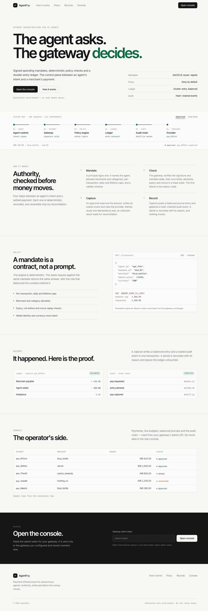
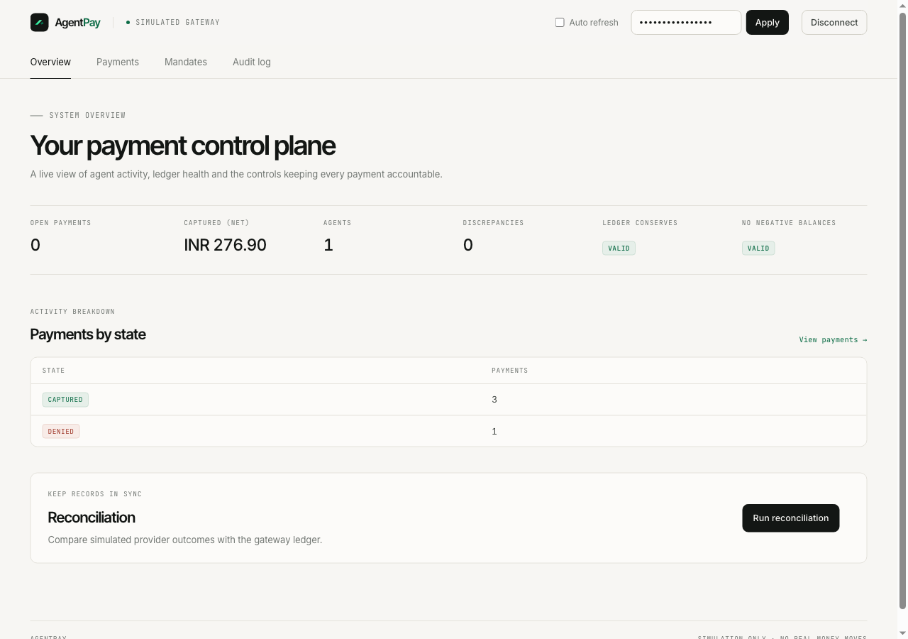

# AgentPayGate

A simulated payment gateway for AI agents. An agent asks to pay a merchant; a **signed mandate**,
enforced by the gateway outside the model, decides whether it may. Approvals reserve budget, the
provider call happens asynchronously through an outbox, and every movement of money is a balanced
double-entry posting.

> **Everything in this repository is simulated.** The provider is a local service that pretends to
> be a PSP. No money moves, no card network is involved, and no real provider is contacted.
>
> The mandate is **AP2-inspired**: limits, merchant/category allowlists, a validity window and an
> issuer signature. It is **not AP2**, not x402, and not any agent-payment protocol. Nothing here is
> production software, PCI-compliant or bank-grade, and the project does not claim otherwise.

## What it does

- Enforces per-transaction, daily and lifetime budgets, merchant/category allowlists, validity
  windows and issuer signatures — deny by default, in a pure Java core with no clock and no I/O.
- Resolves merchant categories from an operator-controlled directory, so a category rule cannot be
  bypassed by an agent that types the allowed category.
- Keeps a double-entry ledger with a business-event idempotency key, a hash-chained audit log, and
  reconciliation against the provider's statement.
- Treats "we do not know" as a first-class state: a timed-out provider call parks the payment in
  `CAPTURE_UNKNOWN` and only reconciliation or a same-key retry can resolve it.
- Exposes five MCP tools over Streamable HTTP at `/mcp`, behind a Go edge proxy that streams, rate
  limits per credential and strips forgeable identity headers.
- Ships a deterministic simulation lab that drives the same cores with a virtual clock and proves
  six planted payment defects are caught by its invariants.

## Quick start

```bash
./mvnw -B verify                      # 98 Java tests, including 12 against real Postgres + psp-sim
(cd edge-proxy && go vet ./... && go test -race ./...)
(cd console && npm ci && npm run check && npm run build)
(cd demo-agent && npm ci && npm run check && npm run build)

docker compose -f deploy/docker-compose.yml up -d --build postgres psp-sim gateway edge
GATEWAY_BASE_URL=http://localhost:18080 GATEWAY_ADMIN_TOKEN=compose-admin-token ./scripts/demo-setup.sh
GATEWAY_BASE_URL=http://localhost:18088 node scripts/mcp-smoke.mjs     # MCP through the edge
node demo-agent/dist/main.js                                           # control + abuse cases
```

`./scripts/verify-all.sh` runs every component's gates and reports each one as PASS, FAIL or ABSENT.
A skipped test is a failure by definition, not a pass.

The full reactor build starts real Postgres and psp-sim containers for the 12 integration tests, so it
needs a running Docker daemon. Without one, `./mvnw -B -DskipITs verify` runs the 86 unit tests.

## Screenshots





## Layout

```
ledger-core/     pure double-entry ledger
policy-core/     mandate, canonical form, Ed25519 signatures, deny-by-default engine
payments-core/   payment state machine, idempotency, provider events, reconciler
sim/             virtual clock, seeded generator, invariants, planted-bug gauntlet, shrinker
mandate-cli/     keygen, mandate signing, simulator CLIs
gateway-app/     Spring Boot gateway: Postgres, outbox, webhooks, admin API, MCP tools
psp-sim/         the simulated provider
edge-proxy/      Go reverse proxy: streaming, rate limits, body caps
console/         TypeScript operator console (Vite, no framework)
demo-agent/      MCP client: control case plus seven abuse cases
deploy/          Dockerfiles, compose stack, Prometheus/Grafana, Kubernetes manifests
load/            closed-loop load generator for the MCP payment path
docs/            architecture, threat model, invariants, fault model, determinism, phase reports
```

## The MCP surface

| Tool | Purpose |
|---|---|
| `request_payment` | ask the gateway to pay; the gateway decides |
| `get_payment_status` | read one of your payments |
| `get_remaining_budget` | what a mandate has left |
| `list_my_mandates` | mandates issued to this agent |
| `describe_deny_reasons` | the reason-code catalogue |

The agent id always comes from the credential, never from a tool argument.

## Verified numbers

| Claim | Evidence |
|---|---|
| 98 Java tests, 0 skipped | `docs/evidence/phase-4-verify.txt` |
| 12 integration tests against real Postgres + a containerised provider | `docs/evidence/phase-3-verify.txt` |
| all six planted defects caught by the invariants | `docs/evidence/phase-4-gauntlet.txt` |
| MCP end to end, through the edge, on the compose stack | `docs/evidence/phase-7-compose.txt` |
| seven abuse cases refused with the expected reason | `docs/ABUSE-RESULTS.md` |
| 200/200 payments approved, p50 96 ms, p95 158 ms at concurrency 8 | `docs/evidence/phase-8-load.txt` |

Measurements are from one laptop with a shared Postgres container. They describe behaviour under
concurrency; they are not a capacity claim. Everything not run is marked UNVERIFIED in
`docs/PROGRESS.md` — notably the Kubernetes manifests, because no cluster was available.

## Documentation

- `docs/architecture.md` — components, request path, data model
- `docs/threat-model.md` — assets, trust boundaries, threats and residual risks
- `docs/invariants.md` — every invariant, where it is enforced, how it is tested
- `docs/fault-model.md` — what fails, what the system does about it
- `docs/determinism.md` — why the pure cores and the lab are reproducible
- `docs/walkthrough/phase-*.md` — what each phase built, and the bugs it found
- `docs/PROGRESS.md` — per-phase commands, exit codes and known gaps

## Licence

MIT — see [LICENSE](LICENSE).

Using it does not make it production software. It is a simulation: no card network, no real money,
no PCI scope, and the security properties described in `docs/threat-model.md` apply to this
simulation only.
