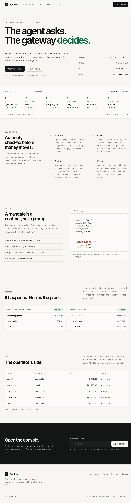

# AgentPayGate — the application guide

Everything you need to run, understand, demo and deploy this project. It is a simulated payments
gateway for AI agents: the same shape as a real control plane, with no card network and no money.

> **Simulation only.** No real provider is contacted, no money moves, and nothing here is
> production software, PCI-compliant or bank-grade. If you deploy it publicly, say the same thing
> on the page.

---

## 1. What this actually is

An AI agent that can spend money is an agent that can be talked into spending money. Prompt
injection, a confused retry loop or a malicious tool result all arrive as "please pay this
merchant". If the model is the thing that decides, the model is the attack surface.

AgentPayGate puts the decision outside the model. A principal signs a **spending mandate** that
names the agent, the merchants and categories it may use, per-transaction / daily / lifetime caps,
and a validity window. Every payment request is checked against that mandate by deterministic Java
code the model cannot reach, and the answer is either an approval with reserved budget or a denial
with a stable reason code. Approved payments are captured asynchronously through an outbox, posted
to a double-entry ledger, and recorded in a hash-chained audit log.

It is a **control plane**, not a wallet: it holds no funds of its own. Wallets are funded through
the admin API in this simulation.

### What it is not

- Not a real payment processor, not PCI scope, no card network, no real PSP.
- Not AP2, not x402, not "an agent payment protocol". The mandate is AP2-*inspired*.
- Not production-ready: one shared operator token, single gateway instance, no TLS in the compose
  stack, rate limiting only in the Go edge and per process.

---

## 2. How it works

A request travels through the components in this order:

```
agent (MCP client)
  │  POST /mcp   JSON-RPC over Streamable HTTP
  ▼
edge-proxy (Go, optional)     streams, rate limits per credential, caps body size, strips
  ▼                           client-supplied identity headers
gateway-app (Java 21)         authenticates the agent key, enforces the mandate, writes Postgres,
  │                           queues the provider call, serves /admin and /mcp
  ├── Postgres                payments, mandates, spend counters, ledger, outbox, audit chain
  └── outbox worker ─────────► psp-sim (Java)   simulated provider: charges, refunds, statement,
                                │              failure modes, HMAC webhooks
                                └── webhook ──► gateway /webhooks/psp
console (TypeScript)          operator views over /admin/*, same origin, token typed by the operator
sim (Java)                    virtual clock + seeded generator driving the same pure cores
```

The important part: `ledger-core`, `policy-core`, `payments-core` and `sim` have no clock, no
threads, no I/O, no randomness and no Spring. The policy decision and the payment state machine are
pure functions, which is why they can be replayed deterministically in tests and in the lab.

### Payment lifecycle

```
REQUESTED → DENIED
REQUESTED → AUTHORIZING → CAPTURED → REFUNDING → REFUNDED
                    ├──► AUTHORIZATION_UNKNOWN
                    └──► CAPTURE_UNKNOWN ──(reconciliation / same-key retry)──► CAPTURED
                                          └──► FAILED
```

`CAPTURE_UNKNOWN` is a first-class state, not an error path: if the provider call times out after
charging, the gateway records "we do not know", and only reconciliation with the provider statement
(or a retry with the same provider idempotency key) resolves it.

---

## 3. Features

### Mandates and policy (`policy-core`)

- Ed25519 issuer signatures over a canonical form; a tampered mandate is rejected at upload time.
- Per-transaction, daily and lifetime caps; `spent + reserved <= maxTotal` checked with
  `Math.addExact`, so overflow is a denial rather than a wrap-around.
- Merchant and category allowlists. **Categories are resolved from the gateway's own merchant
  directory**, so an agent cannot claim to be a grocer to pass a category rule.
- Validity window (not-before / expiry), currency match, agent match, nonce replay protection.
- Deny by default, fixed evaluation order, first failure becomes the reason code
  (`AMOUNT_OVER_TX_LIMIT`, `MERCHANT_NOT_ALLOWED`, `CURRENCY_MISMATCH`, `AMOUNT_NOT_POSITIVE`,
  `EXPIRED`, `NOT_YET_VALID`, `DAILY_LIMIT`, `TOTAL_LIMIT`, `AGENT_MISMATCH`, `REPLAYED`, …).

### Payments (`payments-core`, `gateway-app`)

- Explicit state machine; illegal transitions are rejected, duplicate and out-of-order provider
  events never move a payment backwards.
- Idempotency keyed by `(agent, idempotency key)` with a payload hash: a replay returns the original
  payment, a different payload is a conflict rather than a silent re-price.
- The provider idempotency key is chosen once per payment and never regenerated — including after a
  crash and restart.
- Outbox pattern: reserving budget and queueing the provider call happen in one transaction, and
  the worker claims rows with `for update skip locked`.
- Reconciliation against the provider statement; only "we were unsure and the provider confirms the
  exact amount" is auto-resolved, everything else is flagged for a human.

### Money records (`ledger-core`)

- Double-entry postings keyed by a business-event id, so a duplicate posting is a no-op.
- The ledger refuses entries that do not sum to zero and refuses to make a non-external account
  negative.
- Hash-chained audit log with a serialised chain head; `/admin/audit/verify` re-walks the chain and
  reports the first broken sequence.

### Agent surface (MCP)

Five tools over Streamable HTTP at `/mcp`, authenticated with `Authorization: Bearer apg_…`:

| Tool | Purpose |
|---|---|
| `request_payment` | ask the gateway to pay; the gateway decides |
| `get_payment_status` | read one of your payments |
| `get_remaining_budget` | what a mandate has left, in minor units |
| `list_my_mandates` | mandates issued to this agent |
| `describe_deny_reasons` | the reason-code catalogue |

The agent id always comes from the credential, never from a tool argument.

### Operator console

- **Overview**: payments by state, captured net, open (in-flight) payments, discrepancy count, and
  two live ledger invariants computed on every load (`ledger conserves`, `no negative balances`).
- **Payments**: list and drill-down with the event timeline and the ledger postings.
- **Mandates**: limits, remaining budget, expiry.
- **Audit log**: hash chain verification plus the entries themselves.
- Run reconciliation from the overview page.

### Edge proxy, lab and observability

- Go reverse proxy: streaming-safe proxying, body caps, per-credential token bucket, strips
  forgeable identity headers.
- Simulation lab: virtual clock, seeded generator, invariants, a six-bug planted-defect gauntlet.
- Spring Actuator health/info/prometheus; optional Prometheus + Grafana in compose.

---

## 4. Tech stack

| Layer | Technology | Notes |
|---|---|---|
| Core modules | Java 21, no framework | `ledger-core`, `policy-core`, `payments-core`, `sim` are pure |
| Gateway | Spring Boot 3.5.3, Spring Security, JDBC, Flyway | stateless API-key auth for agents, admin token for operators |
| Agent transport | Spring AI MCP server 1.1.8, Streamable HTTP | JSON or SSE responses |
| Database | PostgreSQL 16 (17 works) | Flyway migrations V1–V3 |
| Provider sim | Spring Boot 3.5.3 | charges, refunds, failure modes, HMAC webhooks |
| Edge | Go (standard library) | streaming proxy + token bucket |
| Console | TypeScript + Vite 5, no framework | hand-built DOM, hash routing |
| Demo agent | TypeScript, Node 22+ | MCP client, control case + 7 abuse cases |
| Tests | JUnit 5, AssertJ, jqwik, ArchUnit, Testcontainers, Awaitility | 86 unit + 12 integration |
| Packaging | Maven reactor, Docker images, Docker Compose | Prometheus/Grafana optional profiles |
| CI | GitHub Actions | Java, Go, TypeScript, integration + compose smoke |

---

## 5. Repository layout

```
ledger-core/     pure double-entry ledger
policy-core/     mandates, canonical form, Ed25519, deny-by-default engine
payments-core/   payment state machine, idempotency, provider events, reconciler
sim/             virtual clock, seeded generator, invariants, planted-bug gauntlet
mandate-cli/     keygen, mandate signing, simulator CLIs
gateway-app/     Spring Boot gateway: Postgres, outbox, webhooks, admin API, MCP tools
psp-sim/         the simulated provider
edge-proxy/      Go reverse proxy
console/         TypeScript operator console + marketing landing page
demo-agent/      MCP client: control case plus seven abuse cases
deploy/          Dockerfiles, compose stack, nginx, Prometheus/Grafana, Kubernetes manifests
sites/           static deploy bundle: a Worker that serves the console build and can proxy its admin API
load/            closed-loop load generator for the MCP payment path
docs/            architecture, threat model, invariants, fault model, determinism, phase reports
```

---

## 6. Run it locally

### Prerequisites

- JDK 21 (Maven comes from the wrapper)
- Node 22+ for the console and demo agent
- Either Docker with Compose, or a PostgreSQL 16/17 you can reach
- Go 1.26+ only if you want to build/run the edge proxy

### Option A — Docker Compose

```bash
./mvnw -B -DskipITs verify                        # builds the jars the images copy
docker compose -f deploy/docker-compose.yml --profile ui up -d --build

GATEWAY_BASE_URL=http://localhost:18080 \
GATEWAY_ADMIN_TOKEN=compose-admin-token ./scripts/demo-setup.sh
```

| Service | URL | Credential |
|---|---|---|
| Console | http://localhost:18090 | admin token `compose-admin-token` |
| Gateway admin API | http://localhost:18080 | header `X-Admin-Token: compose-admin-token` |
| Edge (agent/MCP entry) | http://localhost:18088 | agent API key from `demo-setup.sh` |
| Provider simulator | http://localhost:18081 | — |
| Postgres | `localhost:15432` | `agentpaygate` / `agentpaygate` |
| Prometheus / Grafana | http://localhost:19090 / http://localhost:13000 | `admin` / `admin` |

Add `--profile monitoring` for Prometheus and Grafana. Full check: `./scripts/compose-smoke.sh`.
Reset everything: `docker compose -f deploy/docker-compose.yml down -v`.

### Option B — no Docker

```bash
./mvnw -B -DskipITs verify

# terminal 1: provider
PSP_PORT=8081 GATEWAY_WEBHOOK_URL=http://127.0.0.1:8090/webhooks/psp \
  java -jar psp-sim/target/psp-sim-0.1.0-SNAPSHOT.jar

# terminal 2: gateway
GATEWAY_PORT=8090 \
GATEWAY_DB_URL=jdbc:postgresql://127.0.0.1:5432/agentpaygate \
GATEWAY_DB_USER=agentpaygate GATEWAY_DB_PASSWORD=agentpaygate \
PSP_BASE_URL=http://127.0.0.1:8081 \
  java -jar gateway-app/target/gateway-app-0.1.0-SNAPSHOT-exec.jar

# terminal 3: seed the demo
GATEWAY_BASE_URL=http://localhost:8090 ./scripts/demo-setup.sh

# terminal 4: console
cd console && npm ci && npm run dev      # http://localhost:5173, token demo-admin-token
```

The console dev server proxies `/admin` and `/actuator` to `http://localhost:8090`, so no CORS
configuration is involved. `demo-setup.sh` writes the demo agent key to `.run/api-key.txt`
(git-ignored), registers merchants and the issuer key, signs `mandate-demo`, and funds the wallet
with 5,000,000 minor units.

**Token difference:** local runs use `demo-admin-token`; the compose stack uses
`compose-admin-token`. Most "401 in the console" reports are this.

### Talk to it

```bash
# operator view
curl -s -H 'X-Admin-Token: demo-admin-token' http://localhost:8090/admin/overview

# MCP: initialize, keep the Mcp-Session-Id header, then call a tool
KEY=$(cat .run/api-key.txt)
SID=$(curl -s -D - -o /dev/null -X POST http://localhost:8090/mcp \
  -H 'Content-Type: application/json' -H 'Accept: application/json, text/event-stream' \
  -H "Authorization: Bearer $KEY" \
  -d '{"jsonrpc":"2.0","id":1,"method":"initialize","params":{"protocolVersion":"2025-06-18","capabilities":{},"clientInfo":{"name":"curl","version":"0"}}}' \
  | grep -i '^mcp-session-id' | tr -d '\r' | cut -d' ' -f2)

curl -s -X POST http://localhost:8090/mcp \
  -H 'Content-Type: application/json' -H 'Accept: application/json, text/event-stream' \
  -H "Authorization: Bearer $KEY" -H "Mcp-Session-Id: $SID" \
  -d '{"jsonrpc":"2.0","id":2,"method":"tools/call","params":{"name":"request_payment","arguments":{
        "mandateId":"mandate-demo","merchantId":"merchant-bookshop","merchantCategory":"groceries",
        "amountMinor":12345,"currency":"INR","idempotencyKey":"demo-1"}}}'
```

Or use the reference agent, which does the control case plus the abuse cases:

```bash
npm --prefix demo-agent ci && npm --prefix demo-agent run build
GATEWAY_BASE_URL=http://localhost:8090 node demo-agent/dist/main.js
```

One abuse case needs a second agent's key, otherwise it reports SKIPPED:

```bash
curl -s -X POST http://localhost:8090/admin/agents -H 'X-Admin-Token: demo-admin-token' \
  -H 'Content-Type: application/json' -d '{"agentId":"agent-thief","displayName":"Abuse demo"}'
# copy the returned apiKey, then:
THIEF_API_KEY=apg_... node demo-agent/dist/main.js     # 7/7 refused
```

### Configuration

| Variable | Default | Used by |
|---|---|---|
| `PORT` | — | gateway, psp-sim (set by PaaS hosts; honoured when present) |
| `GATEWAY_PORT` | `8080` | gateway |
| `GATEWAY_DB_URL` | `jdbc:postgresql://localhost:5432/agentpaygate` | gateway |
| `GATEWAY_DB_USER` / `GATEWAY_DB_PASSWORD` | `agentpaygate` | gateway |
| `PSP_BASE_URL` | `http://localhost:8081` | gateway |
| `PSP_TIMEOUT_MS` | `2000` | gateway |
| `GATEWAY_ADMIN_TOKEN` | `demo-admin-token` | gateway admin API |
| `WEBHOOK_SECRET` | `demo-webhook-secret` | gateway + psp-sim HMAC |
| `OUTBOX_POLL_INTERVAL_MS` / `OUTBOX_ENABLED` | `250` / `true` | gateway |
| `PSP_PORT` | `8081` | psp-sim |
| `GATEWAY_WEBHOOK_URL` | `http://localhost:8080/webhooks/psp` | psp-sim |
| `EDGE_ADDR` / `EDGE_UPSTREAM` / `EDGE_RATE_*` | `:8088` / gateway / 20,40 | edge proxy |
| `VITE_GATEWAY_URL` | same origin | console build |
| `VITE_ALLOWED_HOST` | — | console dev server host allowlist |

---

## 7. Six-minute demo

1. **Landing page.** "An agent asks; the gateway decides." Let the system map run once, then press
   **Over limit** — policy goes red, later components are "not reached".
2. **Console** (`demo-admin-token`). Point at `ledger conserves: valid` and
   `no negative balances: valid`: both are computed from the ledger on every page load.
3. **Make a payment.** `node scripts/mcp-smoke.mjs`. Refresh the console: a new `CAPTURED` payment
   with a `psp_…` reference. Open it: `AUTH_STARTED` → `CAPTURE_SUCCEEDED`, then exactly two
   postings, wallet − and merchant payable +.
4. **Run the abuse suite.** `node demo-agent/dist/main.js`: over the per-tx cap, merchant not
   allowlisted, wrong currency, zero amount, another agent's mandate, reused key with a different
   amount — each refused by the gateway with its reason code.
5. **Idempotency.** The suite's retry returns the same payment id with `replayed: true`; the ledger
   still has two postings.
6. **The unknown.** Set `{"timeoutAfterCharge":true}` on the provider, make a payment, watch it
   reach `CAPTURE_UNKNOWN`, reset the failure mode, then press **Run reconciliation** in the
   console. It auto-resolves, captures, and the ledger still balances.
7. **Audit.** Hash chain valid with N entries; editing any stored field breaks the chain from that
   point (the integration test does exactly this).

Say the scope out loud: simulated, single instance, shared operator token, no TLS in compose. It
makes the rest of the claims credible.

---

## 8. Deploying it

### What can be hosted where, for free

| Piece | Free option | Catch |
|---|---|---|
| Landing + console (static) | Vercel Hobby, Cloudflare Pages, Render static site | static only; the console needs an API to be useful |
| Gateway (Java, Docker) | Render free web service, Koyeb free service, Oracle Always Free VM | 512 MB / 0.1 CPU, sleeps when idle (~1 min cold start on Render) |
| Provider simulator (Java) | same as gateway | a second sleeping service |
| Postgres | Neon free, Supabase free, Prisma Postgres free | Render's own free Postgres expires 30 days after creation |
| Edge proxy (Go) | skip it for a demo, or a third service | extra hop, extra cold start |
| TLS / public hostname | Cloudflare Tunnel (free), Caddy + domain | a tunnel URL is fine for a demo link |

Render's free **Postgres is not suitable**: it is deleted 30 days after creation. Use Neon.

### Path A — one free VM, everything at once (recommended, most faithful)

A 2 OCPU / 12 GB Arm VM from Oracle Cloud Always Free runs the whole compose stack, which is the
only topology where the console's nginx proxy, the edge and the provider-sim webhooks all reach
each other by service name. Oracle needs a card for identity verification (not charged on the free
tier), and idle instances can be reclaimed, so it suits a demo, not a service.

```bash
# on a fresh Ubuntu VM
sudo apt update && sudo apt install -y docker.io docker-compose-v2 git openjdk-21-jdk
git clone https://github.com/vipulshetty/Agentpay.git agentpay && cd agentpay

./mvnw -B -DskipITs package          # jars for the images
```

Stop publishing the operator surface to the whole internet — Docker's port mapping bypasses `ufw`,
so bind the gateway, provider and console to loopback and reach them through the tunnel:

```bash
sed -i -e 's/"18080:8080"/"127.0.0.1:18080:8080"/' \
       -e 's/"18081:8081"/"127.0.0.1:18081:8081"/' \
       -e 's/"18090:80"/"127.0.0.1:18090:80"/' deploy/docker-compose.yml
```

Then override the two demo credentials, so you are not shipping `compose-admin-token`:

```yaml
# deploy/docker-compose.demo.yml
services:
  gateway:
    environment:
      GATEWAY_ADMIN_TOKEN: ${DEMO_ADMIN_TOKEN:?set DEMO_ADMIN_TOKEN}
      WEBHOOK_SECRET: ${DEMO_WEBHOOK_SECRET:?set DEMO_WEBHOOK_SECRET}
  psp-sim:
    environment:
      WEBHOOK_SECRET: ${DEMO_WEBHOOK_SECRET:?set DEMO_WEBHOOK_SECRET}
```

```bash
export DEMO_ADMIN_TOKEN="$(openssl rand -hex 24)"
export DEMO_WEBHOOK_SECRET="$(openssl rand -hex 24)"
docker compose -f deploy/docker-compose.yml -f deploy/docker-compose.demo.yml \
  --profile ui up -d --build

GATEWAY_BASE_URL=http://localhost:18080 GATEWAY_ADMIN_TOKEN="$DEMO_ADMIN_TOKEN" \
  ./scripts/demo-setup.sh
```

Put it on the internet with a tunnel instead of opening ports:

```bash
curl -L -o cloudflared https://github.com/cloudflare/cloudflared/releases/latest/download/cloudflared-linux-arm64
chmod +x cloudflared
./cloudflared tunnel --url http://localhost:18090      # console URL
./cloudflared tunnel --url http://localhost:18080      # gateway URL, for the console's API if hosted elsewhere
```

Keep the console behind Cloudflare Access or basic auth: the admin token is a shared operator
credential, and anyone with it can read every payment and run reconciliation.

### Path B — Vercel + Render + Neon (all free, split services)

Use this when you want a permanent URL without managing a VM. The console is static; the gateway
and provider run as two Docker web services; Postgres is Neon.

**Shortcut:** the repository ships [`render.yaml`](../render.yaml). Apply it as a Blueprint
(Dashboard → Blueprints → New Blueprint Instance → this repository) and it creates both Docker
services from the Dockerfiles below, generates the admin token and one shared webhook secret, and
prompts for the database values. The manual steps below are exactly what that blueprint does, so
they double as the explanation.

1. **Database — Neon.** Create a project, copy the pooled connection string, and turn it into:
   `GATEWAY_DB_URL=jdbc:postgresql://<host>/<db>?sslmode=require`, plus the user and password.
   Flyway creates the schema on first boot.
2. **Gateway — Render web service.** New → Web Service → Docker, repository
   `vipulshetty/Agentpay`, Dockerfile `deploy/Dockerfile.gateway.paas`. Environment:
   `GATEWAY_DB_URL`, `GATEWAY_DB_USER`, `GATEWAY_DB_PASSWORD`, a long random
   `GATEWAY_ADMIN_TOKEN`, a random `WEBHOOK_SECRET`, and
   `PSP_BASE_URL=https://<your-psp-service>.onrender.com`. Render sets `PORT`; the gateway binds it.
3. **Provider — Render web service.** Dockerfile `deploy/Dockerfile.psp.paas`, with
   `GATEWAY_WEBHOOK_URL=https://<your-gateway-service>.onrender.com/webhooks/psp` and the same
   `WEBHOOK_SECRET`.
4. **Console — Vercel.** Root directory `console`, build `npm ci && npm run build`, output `dist`.
   Add `console/vercel.json` so the browser stays on one origin (no CORS, token never in a URL):

   ```json
   {
     "rewrites": [
       { "source": "/admin/:path*", "destination": "https://<your-gateway-service>.onrender.com/admin/:path*" },
       { "source": "/actuator/:path*", "destination": "https://<your-gateway-service>.onrender.com/actuator/:path*" }
     ]
   }
   ```

5. **Seed the deployment** from your machine:

   ```bash
   GATEWAY_BASE_URL=https://<your-gateway-service>.onrender.com \
   GATEWAY_ADMIN_TOKEN=<the token you set> ./scripts/demo-setup.sh
   ```

6. **Point the demo agent at it** (optional):
   `GATEWAY_BASE_URL=https://<gateway> AGENT_API_KEY=apg_... node demo-agent/dist/main.js`

Caveats you should repeat to anyone you send the link to:

- both services sleep after 15 minutes idle and take about a minute to wake; the first request after
  a nap will look slow, and Vercel's proxy may time out on it;
- each free service is 512 MB / 0.1 CPU — enough for this, not for a load test;
- 750 free instance hours per workspace per month, shared; sleeping services do not consume them;
- the provider must be able to reach the gateway's public webhook URL, and both must share the same
  `WEBHOOK_SECRET`;
- do not use Render's free Postgres (30-day expiry) — Neon's free plan has no expiry.

### Path C — frontend only

`console/dist` is a static build; hosting it on Vercel or Cloudflare Pages gives you the landing
page and the console shell. Without a backend the console shows its error panel after you enter a
token, which is acceptable if the page says so. This is the cheapest way to have a link, and the
README screenshots do the rest.

#### The copy deployed for this project

- Landing + console shell: <https://agentpaygate-i8wccc.freebuff.site>
- Preview of the same build: <https://agentpaygate-i8wccc-preview.freebuff.site>



That is the static bundle in [`sites/`](../sites): a Worker that serves `console/dist` and, when
`GATEWAY_ORIGIN` is set in the host's environment, forwards `/admin` and `/actuator` to that origin
so the console stays same-origin and usable. Set `GATEWAY_ORIGIN=https://<your-gateway-host>` there
and redeploy once the gateway exists. Until then the console shows its connection error, which is
the honest state of a frontend with no backend behind it.

### Deploying publicly? Do these first

1. Change `GATEWAY_ADMIN_TOKEN` and `WEBHOOK_SECRET`; never ship `compose-admin-token` or
   `demo-webhook-secret`.
2. Put the console behind auth (Cloudflare Access, basic auth, Vercel password protection) or accept
   that anyone with the link can read the payments and press reconciliation.
3. Keep the "simulation only, no real money" line visible on the page.
4. Do not put anything real behind it: the provider is a simulator and the ledger is a demo ledger.

---

## 9. What is verified, and what is not

Run in this repository, with commands and output recorded in `docs/evidence/` and
`docs/PROGRESS.md`:

- 86 unit tests, 0 skipped (`./mvnw -B -DskipITs verify`).
- A real gateway against real PostgreSQL and a real psp-sim process: capture, denial with reason
  code, idempotent replay, provider timeout → `CAPTURE_UNKNOWN` → reconciliation → `CAPTURED`,
  balanced ledger, valid audit chain.
- `node scripts/mcp-smoke.mjs` over Streamable HTTP, and `demo-agent` with 7/7 abuse cases refused.
- Console TypeScript check and production build.
- Compose stack, edge proxy and Testcontainers integration suite per the recorded phase evidence
  (they need Docker/the Go toolchain, which the machine that re-verified the rest did not have).
- The console build deployed as a static site and opened in Chromium: HTML, JS, CSS and fonts served
  with the right content types, no console errors, landing page rendered; the `/admin` proxy path
  in `sites/worker.js` was tested against a gateway running locally (real JSON back, lookalike
  paths not proxied).

Not verified anywhere, and not claimed: the Kubernetes manifests, TLS termination, multi-instance
gateway behaviour, Postgres fault injection, console UI tests and accessibility.

---

## 10. Troubleshooting

| Symptom | Cause | Fix |
|---|---|---|
| Console shows 401 for every page | wrong admin token for this stack | local `demo-admin-token`, compose/VM your own token |
| `Blocked request. This host is not allowed.` | Vite dev server host allowlist | set `VITE_ALLOWED_HOST=<hostname>` |
| Gateway fails on boot with a Flyway/driver error | no database, or wrong credentials | check `GATEWAY_DB_URL`, user, password; Neon needs `?sslmode=require` |
| Compose build fails on `COPY ...-exec.jar` | jars were never built | `./mvnw -B -DskipITs package` before `docker compose build` |
| Payments stay `AUTHORIZING` | provider unreachable, or the outbox is disabled | check `PSP_BASE_URL` and `OUTBOX_ENABLED`; look at gateway logs |
| Provider webhooks rejected | different `WEBHOOK_SECRET` on the two services | set the same value on gateway and psp-sim |
| Demo agent says the `AGENT_MISMATCH` case is SKIPPED | no second agent key | create `agent-thief` and export `THIEF_API_KEY` |
| First request after a while takes ~60 s | free PaaS cold start | expected; warm it before a demo |

---

## 11. Licence

MIT — see [LICENSE](../LICENSE). Using it does not make it production software; it is a simulation
with the same control-plane shape as a real gateway.
